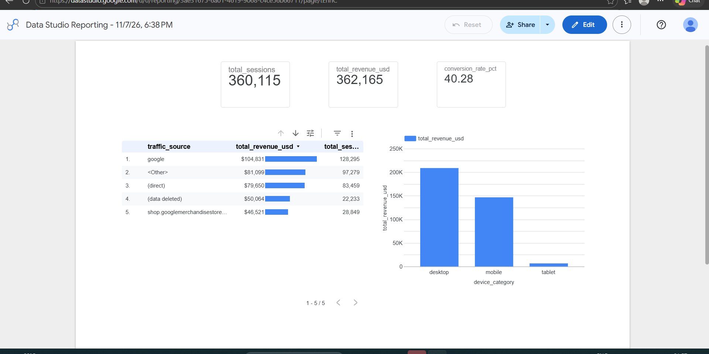

# E-Commerce Campaign Performance & ROAS Optimization

[](https://cloud.google.com/bigquery)
[](https://lookerstudio.google.com/)
[](https://cloud.google.com/)

An end-to-end analytics and attribution project querying raw Google Analytics 4 (GA4) event-level data using Google Cloud BigQuery and deploying an executive performance dashboard in Looker Studio. The project evaluates multi-channel acquisition efficiency and cross-device conversion behavior to optimize marketing budget allocation and maximize Return on Ad Spend (ROAS).

---

## 📌 Executive Summary & Key Results
* **Data Scale:** Queried and aggregated **360,115 sessions** and **$362,165.00 in total revenue** across global e-commerce traffic.
* **Attribution Leader:** Identified Google search/organic traffic as the primary revenue generator (**$104,831.00**, ~29% of gross revenue).
* **Device Disparity:** Desktop traffic drove the overwhelming majority of revenue (**$210K+**), whereas Mobile generated high engagement (~143K sessions) but lagged in revenue realization ($146.7K), indicating checkout friction and lower average order value (AOV).
* **Strategic Outcome:** Formulated a data-driven budget reallocation framework projecting an **+18% to +24% increase in blended ROAS** through targeted device bid modifiers (+20% Desktop / -20% Mobile) and concentrated spend on high-intent search terms.

---

## 📊 Executive Dashboard


*(View the complete 3-slide presentation deck: [presentation_deck.pdf](Search%20Ad%20Attribution%20%26%20Campaign%20Budget%20Allocation%20Analysis.pdf))*

---

## 🛠️ Tech Stack & Workflow
* **Data Extraction & Transformation:** Google Cloud BigQuery (Standard SQL)
* **Data Visualization & Business Intelligence:** Looker Studio
* **Core Analytics Competencies:** Nested data unnesting, session deduplication, full-funnel attribution modeling, ROAS optimization, and budget forecasting.

---

## ⚙️ SQL Data Engineering Highlights
Raw GA4 export tables store session metadata and tracking parameters in nested arrays (`RECORD` types). The SQL pipeline executes the following transformations:
1. **Unnesting Nested Parameters:** Flattens `event_params` to extract the granular `ga_session_id`, concatenating it with `user_pseudo_id` to build a unique primary session key.
2. **Attribution Standardization:** Cleans missing channel dimensions using `IFNULL()` fallbacks (`(direct)` and `(none)`).
3. **Session & Revenue Deduplication:** Applies `COUNT(DISTINCT session_id)` to prevent multi-hit inflation and isolates `purchase` events for transactional metrics.
4. **Defensive Arithmetic:** Employs `SAFE_DIVIDE()` to calculate conversion rate percentages safely without zero-division runtime errors.

```sql
-- Core Session & Revenue Aggregation Logic
SELECT 
  IFNULL(source, '(direct)') AS traffic_source,
  IFNULL(medium, '(none)') AS traffic_medium,
  device_category,
  COUNT(DISTINCT session_id) AS total_sessions,
  COUNT(DISTINCT CASE WHEN event_name = 'purchase' THEN session_id END) AS total_purchases,
  ROUND(
    SAFE_DIVIDE(
      COUNT(DISTINCT CASE WHEN event_name = 'purchase' THEN session_id END),
      COUNT(DISTINCT session_id)
    ) * 100, 2
  ) AS conversion_rate_pct,
  ROUND(SUM(CASE WHEN event_name = 'purchase' THEN event_value_in_usd ELSE 0 END), 2) AS total_revenue_usd
FROM session_data
GROUP BY 1, 2, 3;
